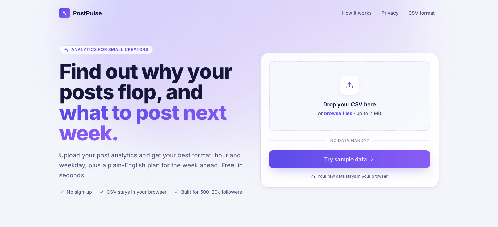
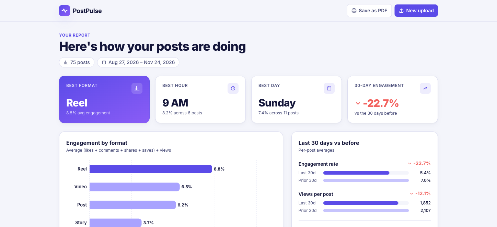

# 📈 PostPulse

**Find out why your posts flop, and what to post next week.**

PostPulse turns a small creator's analytics export into plain-English advice. Upload your data, see what's working, and get a specific plan for the week ahead.

🔗 **Live demo:** coming soon (see [Deploy](#deploy) to host your own on Vercel)

[](https://github.com/SatwikaGanji06/Postpulse/actions/workflows/ci.yml)

| Upload | Report |
|---|---|
|  |  |

---

## The Problem

Big analytics tools (Hootsuite, Sprout Social) are built for brands and priced accordingly. Small creators with 500 to 20k followers just see raw numbers and have no idea what to change.

## The Solution

Upload a CSV of your post analytics. PostPulse:

1. Computes the stats that matter (engagement, best time, best format, trends)
2. Sends only the **aggregated stats** to an AI model
3. Returns clear, actionable insights in plain English

## Features

- 📂 CSV upload, or one-click **sample data** demo
- 📊 Engagement rate by format (Reel, post, story, video)
- ⏰ Best posting hour and best weekday
- 🏆 Top 5 and bottom 5 posts (never the same post in both)
- 📉 30-day vs previous 30-day trend, for engagement and views
- 🤖 AI insights: what's working, what's not, next week's plan, caption tips
- 📋 Copy next week's plan, or save the whole report as a PDF
- 📱 Mobile-friendly UI, keyboard accessible, matches the pitch-deck branding
- 🔒 Raw data stays in your browser; only aggregated stats are sent to the AI
- 💬 Built-in feedback form to collect pilot-creator feedback

## Tech Stack

| Layer | Tech |
|---|---|
| Framework | Next.js 16 (App Router) + React 19 + TypeScript |
| Styling | Tailwind CSS |
| Charts | Recharts |
| CSV parsing | PapaParse |
| AI | Anthropic API |
| Rate limiting | Upstash Redis (optional) |
| Tests | Vitest |
| Hosting | Vercel |

## Expected CSV Format

| Column | Example |
|---|---|
| `date` | 2026-10-14 |
| `format` | reel |
| `caption` | My morning routine |
| `views` | 3200 |
| `likes` | 210 |
| `comments` | 14 |
| `shares` | 9 |
| `saves` | 31 |

Headers are case-insensitive and invalid rows are skipped. A sample file is in `public/sample.csv`.

## Getting Started

### Prerequisites

- Node.js 20.9+ (required by Next.js 16)
- An Anthropic API key from [console.anthropic.com](https://console.anthropic.com)

### Setup

```bash
# 1. Clone the repo
git clone https://github.com/SatwikaGanji06/Postpulse.git
cd Postpulse

# 2. Install dependencies
npm install

# 3. Add your API key
cp .env.example .env.local
# then edit .env.local and set ANTHROPIC_API_KEY

# 4. Run the app
npm run dev
```

Open [http://localhost:3000](http://localhost:3000) and click **Try sample data**.

### Environment Variables

| Variable | Description |
|---|---|
| `ANTHROPIC_API_KEY` | Your Anthropic API key (server-side only). Without it the app runs in demo mode with rule-based tips. |
| `ANTHROPIC_MODEL` | Optional. Model id to use (default `claude-sonnet-5-5`, which the cost estimate in the deck assumes). |
| `UPSTASH_REDIS_REST_URL` | Optional. Shared rate limit across server instances (recommended in production). |
| `UPSTASH_REDIS_REST_TOKEN` | Optional. Goes with the URL above. |

### Scripts

| Command | What it does |
|---|---|
| `npm run dev` | Start the dev server |
| `npm test` | Run the unit tests (stats engine + API route) |
| `npm run lint` | ESLint |
| `npm run build` | Production build |

CI runs lint, type-check, tests and build on every push and pull request.

## Project Structure

```
postpulse/
├── app/
│   ├── page.tsx              # Home + upload
│   ├── results/              # Results dashboard
│   └── api/insights/route.ts # AI insights endpoint (+ route.test.ts)
├── components/               # Shared UI, format chart, insight cards
├── lib/
│   ├── analyze.ts            # Pure stats functions (+ analyze.test.ts)
│   └── rateLimit.ts          # Per-IP limit for the AI endpoint
├── docs/                     # README screenshots
├── .github/                  # CI workflow and feedback issue form
├── public/
│   └── sample.csv            # Demo dataset
└── .env.example
```

## How It Works

```
CSV upload → parse in browser → compute stats (lib/analyze.ts)
          → POST aggregated stats to /api/insights
          → AI returns structured JSON → render cards + charts
```

## Deploy

PostPulse is a standard Next.js app, so [Vercel](https://vercel.com) (free Hobby plan) is the easiest host.

1. **Get an Anthropic API key** at [console.anthropic.com](https://console.anthropic.com) → *API Keys*. Add a small amount of credit and set a monthly spend limit under *Billing* so a public demo can't run up a bill.
2. **Import the repo:** on Vercel click *Add New → Project*, choose this GitHub repo. Framework preset **Next.js** is detected automatically; leave build settings as they are.
3. **Add environment variables** (Project → *Settings → Environment Variables*):
   - `ANTHROPIC_API_KEY` = your key (required for real AI insights; without it the site runs in demo mode)
   - `ANTHROPIC_MODEL` (optional) to change the model
4. **Deploy.** Every push to `main` redeploys automatically, and pull requests get preview URLs.
5. **Protect the AI endpoint (recommended).** Vercel runs many server instances, so the built-in in-memory limit is per instance. For a real shared limit of 10 requests/minute per visitor:
   - Create a free Redis database at [upstash.com](https://upstash.com) (or add *Upstash* from Vercel → *Storage / Marketplace*, which fills in the variables for you).
   - Set `UPSTASH_REDIS_REST_URL` and `UPSTASH_REDIS_REST_TOKEN` in Vercel and redeploy.
6. **Check it:** open the site, click *Try sample data*, and confirm the badge above the insights says **Written by AI from your stats** (not *Demo mode*). Then put the URL in the *Live demo* line at the top of this README.

Node 20.9+ is required; Vercel's default Node version already meets this.

## Roadmap

- [ ] YouTube Data API connection (no CSV needed)
- [ ] Instagram Graph API via OAuth
- [ ] Weekly email report
- [ ] Competitor comparison
- [ ] AI content calendar and caption generator
- [ ] User accounts and history
- [ ] Paid plans (free weekly report, premium for calendar and comparisons)

## Contributing

Issues and PRs are welcome. For big changes, open an issue first to discuss.

## License

[MIT](LICENSE)

---

Built by [Ganji Satwika](https://github.com/SatwikaGanji06) · Questions or feedback? [Open an issue](https://github.com/SatwikaGanji06/Postpulse/issues).
